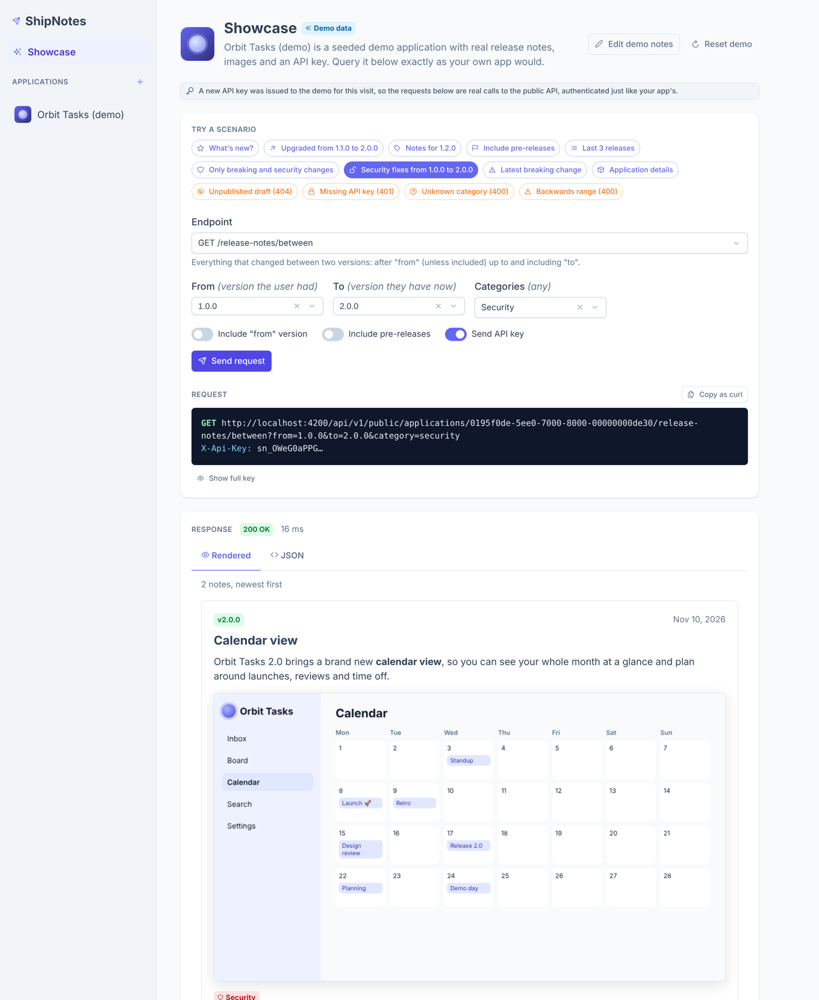

# ShipNotes

ShipNotes lets you write release notes for your applications and serve them to those applications through an API.

- **Applications** (name, icon URL, API key) are listed in the side panel.
- Each application has **release notes per semantic version**, written in a rich text editor and saved as draft or published.
- Each note has an optional **summary** plus one rich text **section per category of change** (Breaking changes, Added, Changed, Deprecated, Removed, Fixed, Security), so apps can filter and style them.
- Consuming apps fetch **published** notes with the application's **API key** and render the HTML.


| Part | Stack | Folder |
| --- | --- | --- |
| Database | SQL Server, schema managed by EF Core migrations | `api/src/ShipNotes.Infrastructure/Persistence/Migrations`, `database/shipnotes.sql` |
| API | .NET 10 ASP.NET Core Web API | `api/` |
| UI | Angular 22 (standalone components, signals), PrimeNG 22 with the Aura theme, ngx-quill | `web/` |

## Running locally

Prerequisites: .NET 10 SDK, Node 22, and Docker (or any SQL Server instance).

```bash
# 1. Database
docker compose up -d

# 2. API on http://localhost:5078 (applies migrations automatically in Development)
cd api
dotnet run --project src/ShipNotes.Api

# 3. UI on http://localhost:4200 (proxies /api to the API)
cd web
npm install
npm start
```

The development connection string is in `api/src/ShipNotes.Api/appsettings.Development.json`. For other environments set `ConnectionStrings__ShipNotes` and `Cors__AdminOrigins__0`, and apply the schema with `database/shipnotes.sql` (an idempotent script) or `dotnet ef database update`.

## Images in release notes

Images are never stored inline in a note. The editor's image button (and pasting or dropping an image file) uploads the file to `POST /api/v1/applications/{id}/media`, which saves it to disk and inserts its URL, e.g. `https://your-api/api/v1/media/{mediaId}/screenshot.png`, into the note. Each upload is tracked in the `MediaData` table (file name, type, size, storage path and the release note that uses it).

- Files are written to `Media:RootPath` (default `F:\Dev\ShipNotesMedia`) as `{applicationId}/{mediaId}.{ext}`.
- Media URLs use `Media:PublicBaseUrl` when set (set it in production, e.g. `Media__PublicBaseUrl=https://notes.example.com`); otherwise the API's own address.
- Only PNG, JPEG, GIF and WebP up to `Media:MaxFileSizeBytes` (5 MB) are accepted; the type is checked from the file's content, not its name.
- When a note is saved the server keeps only `` tags pointing at media uploaded to that application, so base64 and hot-linked images are removed. Removing an image from a note, or deleting the note or application, deletes the files too.
- `GET /api/v1/media/{mediaId}/{fileName}` is anonymous and cacheable, so consuming apps can render the note HTML as-is and the images load.

## Categories

A release note is an optional summary (intro text, highlights, screenshots) followed by at most one section per category. The whole note is written in one editor: put the cursor on a line (or select several) and pick a category from the **Section** picker at the start of the toolbar. Lines in a section get a coloured bar and the category's label; pick **Summary** to take them out again, or press Enter on an empty line to end a section. Lines outside any section are the summary.

When you save, the editor splits the note into the summary and its sections. A category used in more than one place is joined into one section, sections come back in the order below, and sections left empty are dropped. Notes saved before the single editor load into it unchanged, with each old section shown as a block of its category.

| Category | Value | Use for |
| --- | --- | --- |
| Breaking changes | `breaking` | Changes that need users or integrators to act |
| Added | `added` | New features |
| Changed | `changed` | Changes to existing behaviour |
| Deprecated | `deprecated` | Features that will be removed later |
| Removed | `removed` | Features that are gone |
| Fixed | `fixed` | Bug fixes |
| Security | `security` | Vulnerability fixes and hardening |

The categories follow [Keep a Changelog](https://keepachangelog.com/), with breaking changes called out first; that is also the order sections are returned in. Sections are stored in the `ReleaseNoteSections` table (one row per note and category, category stored by name). Notes written before categories existed keep their content as the summary, so nothing is lost; open them and move items into sections if you want them filterable.

## Querying release notes from your app

Every request must send the application's API key in the `X-Api-Key` header, and the URL names the application the key was issued to. The key is checked against that application on every call:

- no key, or an unknown key: `401 Unauthorized`
- a valid key for a different application (or an application id that doesn't exist): `403 Forbidden`

The application id is shown on the application's **Integration** tab. Only published notes are returned, newest version first. Paths below are relative to `/api/v1/public/applications/{applicationId}`.

| Endpoint | Description |
| --- | --- |
| `GET /release-notes` | List notes. Query: `after` (exclusive), `upTo` (inclusive), `category`, `includePreReleases` (default `false`), `limit` (1–100, default 20). |
| `GET /release-notes/between` | All notes between two versions. Query: `from` (required, exclusive), `to` (required, inclusive), `category`, `includeFrom` (default `false`; set `true` to include `from` itself), `includePreReleases` (default `false`). Returns `400` if `from` is later than `to`. |
| `GET /release-notes/latest` | Newest published note. Query: `category`, `includePreReleases`. |
| `GET /release-notes/{version}` | Note for one version, e.g. `1.4.0`. Query: `category`. |
| `GET /` | Application name and icon URL. |

Versions are compared by [semver precedence](https://semver.org/#spec-item-11), not as text: `1.10.0` is after `1.9.0`, `2.0.0-beta.1` is before `2.0.0`, and build metadata (`+build.5`) is ignored.

`category` filters by [category](#categories): repeat it (`?category=breaking&category=security`) or comma-separate it (`?category=breaking,security`); names are case-insensitive. Only notes with at least one of those categories are returned (`limit` counts after filtering, and `latest` returns the newest matching note), and each note includes only those sections. On `/{version}` it only narrows the sections. An unknown category returns `400`.

`between` excludes `from` and includes `to` because the usual question is "the user had 1.2.0 and now has 1.5.0, what changed?": they already saw 1.2.0's notes, and 1.5.0's notes are part of the answer.

```bash
# "What changed between the version this user last saw and the one they have now?"
curl -H "X-Api-Key: $SHIPNOTES_API_KEY" \
  "https://your-shipnotes-host/api/v1/public/applications/$SHIPNOTES_APP_ID/release-notes/between?from=1.2.0&to=1.5.0"

# Only breaking changes and security fixes
curl -H "X-Api-Key: $SHIPNOTES_API_KEY" \
  "https://your-shipnotes-host/api/v1/public/applications/$SHIPNOTES_APP_ID/release-notes?category=breaking,security"
```

```json
[
  {
    "version": "1.5.0",
    "isPreRelease": false,
    "title": "Dark mode",
    "summaryHtml": "<p>Dark mode is here.</p>",
    "sections": [
      { "category": "added", "label": "Added", "contentHtml": "<ul><li>Dark mode</li></ul>" },
      { "category": "fixed", "label": "Fixed", "contentHtml": "<ul><li>Faster start-up</li></ul>" }
    ],
    "contentHtml": "<p>Dark mode is here.</p><section class=\"note-section note-section--added\" data-category=\"added\"><h2 class=\"note-section__title\">Added</h2><ul><li>Dark mode</li></ul></section><section class=\"note-section note-section--fixed\" data-category=\"fixed\"><h2 class=\"note-section__title\">Fixed</h2><ul><li>Faster start-up</li></ul></section>",
    "publishedAt": "2026-11-10T20:00:45+00:00"
  }
]
```

Use `summaryHtml` and `sections` to lay notes out yourself (for example, a coloured badge per category). `contentHtml` is the same note as one ready-to-render fragment, with each section wrapped in `<section class="note-section note-section--{category}" data-category="{category}">` and an `<h2 class="note-section__title">` heading, so you can style each kind of change with plain CSS:

```css
.note-section { border-left: 3px solid #94a3b8; padding-left: 1rem; }
.note-section--breaking { border-color: #dc2626; }
.note-section--added { border-color: #16a34a; }
.note-section--fixed { border-color: #0d9488; }
.note-section__title { font-size: 0.75rem; text-transform: uppercase; }
```

 All HTML is sanitised on the server with an allow-list, so it can be rendered directly. The public endpoints allow any origin (CORS) and are rate limited to 120 requests per minute per key.

## Showcase

Open **Showcase** at the top of the side panel to see the whole flow working without writing anything yourself.



- The first visit seeds a demo application, **Orbit Tasks (demo)**, with nine release notes from 1.0.0 to 2.1.0: stable versions, a patch release, two pre-releases, a major version and an unpublished draft, using every category between them. Several notes contain screenshots, which are uploaded through the normal media pipeline, so they are stored under `Media:RootPath` and tracked in `MediaData` like any other image.
- The page is a live console for the public API. Pick a scenario ("Upgraded from 1.1.0 to 2.0.0", "Security fixes from 1.0.0 to 2.0.0", "Latest breaking change", "Missing API key (401)" and so on), filter by category, or build a request yourself, then see the exact request, a curl command, the status and timing, the raw JSON, and the notes rendered with their images as a consuming app would show them.
- Each visit issues the demo a new API key (keys are still only shown once), so a key copied from an earlier visit stops working. **Reset demo** deletes the demo application, including any edits, and seeds it again.
- The demo is a normal application, so you can open it from the side panel and edit its notes.
- Endpoints: `POST /api/v1/showcase/session` and `POST /api/v1/showcase/reset`. They return `404` unless `Showcase:Enabled` is `true`, which it is only in `appsettings.Development.json`. Leave it off in production, because anyone who can reach the admin API could rotate the demo key.
- The demo content lives in `api/src/ShipNotes.Application/Showcase/Content` (HTML notes and PNG images, embedded in the assembly) and the list of notes in `ShowcaseCatalog.cs`. Each note's summary is `{version}.html` and each section is `{version}.{category}.html`, e.g. `2.0.0.breaking.html`.

## Design notes

**API layers** (`api/src`), each project depending only on the one before it:

- `ShipNotes.Domain`: entities (`ClientApplication`, `ReleaseNote` with its `ReleaseNoteSection`s and `ReleaseNoteCategory`) and the `SemanticVersion` value object. Versions are stored with a `VersionSortKey` whose ordinal order matches semver precedence, so sorting and range filters run in SQL on one indexed column.
- `ShipNotes.Application`: use-case services, DTOs, FluentValidation validators, and the interfaces infrastructure implements (repositories, unit of work, API key service, HTML sanitiser).
- `ShipNotes.Infrastructure`: EF Core `DbContext`, entity configurations, repositories, migrations, API key hashing, and HTML sanitisation.
- `ShipNotes.Api`: thin controllers, API key authentication handler, problem-details error handling, CORS, and rate limiting.

**API keys** are 256-bit random values (`sn_…`). Only a SHA-256 hash and a short display prefix are stored, so a key is shown once when it's created or regenerated.

**UI** (`web/src/app`):

- `core/`: models, API clients, the signal-based `ApplicationsStore`, notifications (PrimeNG toast), the HTTP error interceptor, and the PrimeNG theme (`core/theme`: Aura with an indigo primary palette).
- `layout/`: the shell, the side panel (PrimeNG menu), and the application nav item.
- `shared/`: reusable UI pieces built on PrimeNG (avatar icon, copy button, API key banner, empty and loading states), the confirm dialog service, the semver validator, and utilities.
- `features/applications` and `features/release-notes`: lazy-loaded routes, with pages that load data and handle navigation, and presentational components for forms and list items.

**PrimeNG licence.** From version 22, PrimeNG needs a licence key; without one it shows an "Invalid PrimeUI License" notice in the corner of the page. Individuals and small teams qualify for the free Community licence at https://primeui.dev/licenses. Put the key in `primeNgLicenseKey` in `web/src/environments/environment*.ts`.

**Admin endpoints** (`/api/v1/applications/...`) don't require sign-in yet. Put them behind your identity provider (for example, Entra ID or Auth0 with JWT bearer) before you deploy anywhere public.

## Tests and checks

```bash
cd api && dotnet test                  # domain, infrastructure and HTTP integration tests (SQLite in-memory)
cd web && npm run test:ci              # Vitest component, store and validator tests
cd web && npx ng lint && npm run format:check
```

CI runs all of these on every push and pull request (`.github/workflows/ci.yml`).
