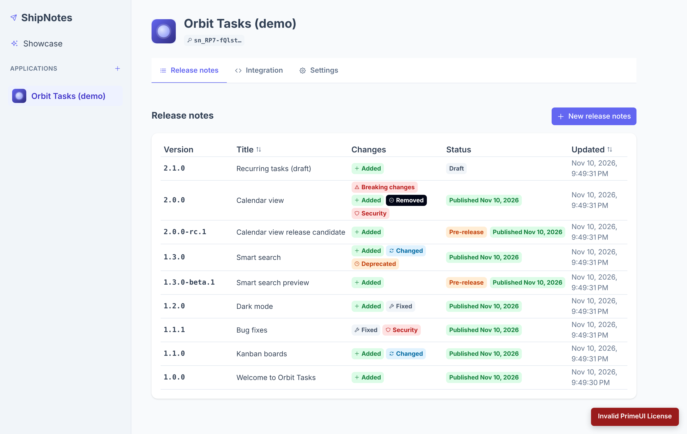

# ShipNotes

ShipNotes lets you write release notes for your applications and serve them to those applications through an API.

- **Applications** (name, icon URL, API key) are listed in the side panel.
- Each application has **release notes per semantic version**, written in a rich text editor and saved as draft or published.
- Consuming apps fetch **published** notes with the application's **API key** and render the HTML.



| Part | Stack | Folder |
| --- | --- | --- |
| Database | SQL Server, schema managed by EF Core migrations | `api/src/ShipNotes.Infrastructure/Persistence/Migrations`, `database/shipnotes.sql` |
| API | .NET 10 ASP.NET Core Web API | `api/` |
| UI | Angular 22 (standalone components, signals), PrimeNG 22 with the Aura theme, ngx-quill | `web/` |

## Running locally

Prerequisites: .NET 10 SDK, Node 22, and Docker (or any SQL Server instance).

```bash
# 1. Database
docker compose up -d

# 2. API on http://localhost:5078 (applies migrations automatically in Development)
cd api
dotnet run --project src/ShipNotes.Api

# 3. UI on http://localhost:4200 (proxies /api to the API)
cd web
npm install
npm start
```

The development connection string is in `api/src/ShipNotes.Api/appsettings.Development.json`. For other environments set `ConnectionStrings__ShipNotes` and `Cors__AdminOrigins__0`, and apply the schema with `database/shipnotes.sql` (an idempotent script) or `dotnet ef database update`.

## Querying release notes from your app

Send the application's API key in the `X-Api-Key` header. Only published notes are returned, newest version first.

| Endpoint | Description |
| --- | --- |
| `GET /api/v1/public/release-notes` | List notes. Query: `after` (exclusive), `upTo` (inclusive), `includePreReleases` (default `false`), `limit` (1–100, default 20). |
| `GET /api/v1/public/release-notes/latest` | Newest published note. Query: `includePreReleases`. |
| `GET /api/v1/public/release-notes/{version}` | Note for one version, e.g. `1.4.0`. |
| `GET /api/v1/public/application` | Application name and icon URL. |

```bash
# "What's new since the version this user last saw?"
curl -H "X-Api-Key: $SHIPNOTES_API_KEY" \
  "https://your-shipnotes-host/api/v1/public/release-notes?after=1.2.0&upTo=1.5.0"
```

```json
[
  {
    "version": "1.5.0",
    "isPreRelease": false,
    "title": "Dark mode",
    "contentHtml": "<p>Highlights</p><ul><li>Dark mode</li></ul>",
    "publishedAt": "2026-11-10T20:00:45+00:00"
  }
]
```

`contentHtml` is sanitised on the server with an allow-list, so it can be rendered directly. The public endpoints allow any origin (CORS) and are rate limited to 120 requests per minute per key.

## Design notes

**API layers** (`api/src`), each project depending only on the one before it:

- `ShipNotes.Domain`: entities (`ClientApplication`, `ReleaseNote`) and the `SemanticVersion` value object. Versions are stored with a `VersionSortKey` whose ordinal order matches semver precedence, so sorting and range filters run in SQL on one indexed column.
- `ShipNotes.Application`: use-case services, DTOs, FluentValidation validators, and the interfaces infrastructure implements (repositories, unit of work, API key service, HTML sanitiser).
- `ShipNotes.Infrastructure`: EF Core `DbContext`, entity configurations, repositories, migrations, API key hashing, and HTML sanitisation.
- `ShipNotes.Api`: thin controllers, API key authentication handler, problem-details error handling, CORS, and rate limiting.

**API keys** are 256-bit random values (`sn_…`). Only a SHA-256 hash and a short display prefix are stored, so a key is shown once when it's created or regenerated.

**UI** (`web/src/app`):

- `core/`: models, API clients, the signal-based `ApplicationsStore`, notifications (PrimeNG toast), the HTTP error interceptor, and the PrimeNG theme (`core/theme`: Aura with an indigo primary palette).
- `layout/`: the shell, the side panel (PrimeNG menu), and the application nav item.
- `shared/`: reusable UI pieces built on PrimeNG (avatar icon, copy button, API key banner, empty and loading states), the confirm dialog service, the semver validator, and utilities.
- `features/applications` and `features/release-notes`: lazy-loaded routes, with pages that load data and handle navigation, and presentational components for forms and list items.

**PrimeNG licence.** From version 22, PrimeNG needs a licence key; without one it shows an "Invalid PrimeUI License" notice in the corner of the page. Individuals and small teams qualify for the free Community licence at https://primeui.dev/licenses. Put the key in `primeNgLicenseKey` in `web/src/environments/environment*.ts`.

**Admin endpoints** (`/api/v1/applications/...`) don't require sign-in yet. Put them behind your identity provider (for example, Entra ID or Auth0 with JWT bearer) before you deploy anywhere public.

## Tests and checks

```bash
cd api && dotnet test                  # domain, infrastructure and HTTP integration tests (SQLite in-memory)
cd web && npm run test:ci              # Vitest component, store and validator tests
cd web && npx ng lint && npm run format:check
```

CI runs all of these on every push and pull request (`.github/workflows/ci.yml`).
